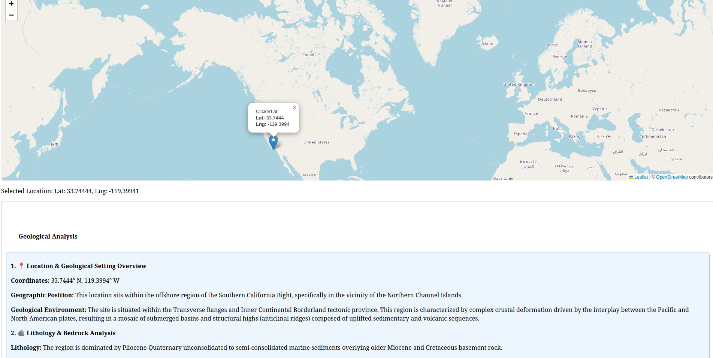
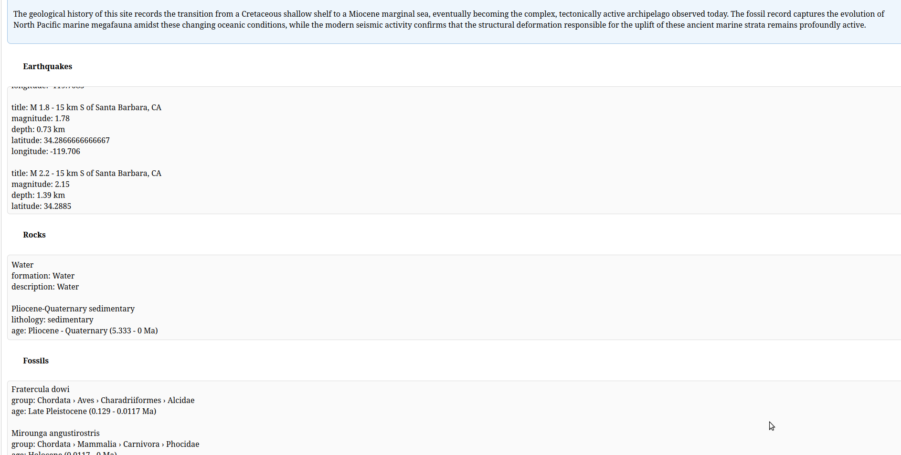

# Geo Agent

An interactive map application that tells you about the geology under any point on Earth. Click a location on the map and a set of [Embabel](https://github.com/embabel/embabel-agent) agent actions gathers data from public geoscience APIs and sends it to a Google Gemini model, which writes a structured geological report. The report and the raw data are shown below the map.

## Screenshots

Clicking a point off the coast of Southern California places a marker and starts the geological analysis:



Below the analysis, the page lists the raw earthquake, rock and fossil data the report was based on:



## What it does

When you click a point, the app collects three kinds of data around it:

| Data | Source | Details |
|------|--------|---------|
| Earthquakes | [USGS Earthquake Catalog](https://earthquake.usgs.gov/fdsnws/event/1/) | Events within 100 km of the point |
| Rock formations | [Macrostrat](https://macrostrat.org/api/v2/) | Geologic units: name, lithology, age, description |
| Fossils | [Paleobiology Database](https://paleobiodb.org/data1.2/) | Up to 20 occurrences in a ~1° box around the point |

The `GeodataAgent` runs one action per data source and a final `summarize` action. Embabel plans the order of the actions toward the goal.

`summarize` sends the coordinates and the collected data to the default Gemini model, using the "expert field geologist" system prompt in `src/main/resources/prompts/field-geologist.md`. The model returns a report with five sections: location and setting, lithology, paleontology and paleoenvironment, seismic and tectonic activity, and a geologic history synthesis. If a data layer is empty, the report says so.

The page shows the analysis in an info box above the raw earthquake, rock and fossil data. If the model call fails, the analysis box shows an error and the raw data is still returned.

## Tech stack

- Java 25
- Spring Boot 4.1.1 (Web MVC, Thymeleaf, RestClient)
- Embabel Agent 1.5.3 with the Google GenAI (Gemini) starter
- Leaflet and OpenStreetMap tiles for the map

## Prerequisites

- JDK 25
- A Google AI API key for Gemini ([get one here](https://aistudio.google.com/app/apikey))
- Internet access (the USGS, Macrostrat and PBDB APIs, plus the map tiles and Leaflet from unpkg)

Maven is not required; the project includes the Maven wrapper.

## Running

1. Set your API key as an environment variable:

   ```bash
   export GOOGLE_API_KEY=your-key-here
   ```

2. Start the application:

   ```bash
   ./mvnw spring-boot:run
   ```

3. Open <http://localhost:8081/map> and click anywhere on the map.

### Building a jar

```bash
./mvnw clean package
java -jar target/geo-agent-0.0.1-SNAPSHOT.jar
```

## Configuration

Settings are in `src/main/resources/application.properties`:

| Property | Default | Description |
|----------|---------|-------------|
| `server.port` | `8081` | HTTP port |
| `embabel.agent.platform.models.googlegenai.api-key` | `${GOOGLE_API_KEY}` | Gemini API key, read from the environment |
| `embabel.models.default-llm` | `gemini-3.1-flash-lite` | Default model used for the geological analysis |

## API

`POST /api/location` takes a JSON body and returns a `GeoReport` with two fields: `summary` (the raw data) and `analysis` (the model's report):

```bash
curl -X POST http://localhost:8081/api/location \
  -H 'Content-Type: application/json' \
  -d '{"latitude": 39.62711, "longitude": 21.31348}'
```

## Project layout

```
src/main/java/com/nikosch/geo/
├── agent/        GeodataAgent: the Embabel agent and its actions
├── client/       GeoApiClients: calls to USGS, Macrostrat and PBDB
├── controller/   MapController: serves the map page and /api/location
├── record/       Data records (Location, Quake, Formation, Fossil, GeoReport)
└── util/         Time helpers
src/main/resources/
├── prompts/field-geologist.md   System prompt for the analysis
└── templates/index.html         Leaflet map page
```

## License

Released under the [MIT License](LICENSE).
